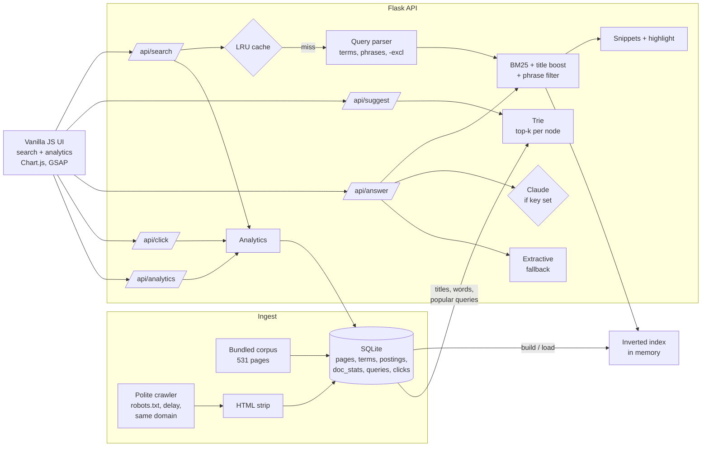

# Sift: a search engine built from scratch

Sift crawls a site politely, builds an inverted index in SQLite, ranks results with BM25 written by hand, and suggests queries from a trie ranked by how often people search them. Every search and click is logged, and an analytics page shows top queries, zero-result queries, click-through rate, p50/p95 latency and cache hit rate. An optional **Answer** mode passes the top BM25 results to Claude for an answer with citations. Without an API key it falls back to an extractive answer, so the app works fully offline.

No search libraries are used: no Elasticsearch, Whoosh, Lucene, rank-bm25 or SQLite FTS. Tokenizing, stemming, the posting lists, scoring, phrase matching, snippets, the trie and the LRU cache are all in this repository and tested.

A bundled corpus of 531 Python standard library pages (docstrings, PSF License) loads on first start, so the demo, tests and benchmark need no network.

## Features

**Crawler** (`sift/crawler.py`)
- Polite by default: obeys robots.txt (including `Crawl-delay`), keeps a minimum delay per host, stays on the seed domains, and stops at a page limit.
- BFS order, URL normalization (fragments removed, host lowercased), skips binary and asset extensions, keeps HTML only, and caps response size.
- Follows RFC 9309 for a missing robots.txt: a 4xx means everything is allowed, a 5xx means nothing is.
- Fetching, clock and sleep are injected, so the tests run on a fake website and a fake clock.

**Indexing and ranking** (`sift/text.py`, `sift/index.py`)
- HTML stripping that drops `<script>`, `<style>`, `<head>` and `<nav>`, plus tokenization, stopwords and a small suffix stemmer (`parse`, `parses`, `parsed` and `parsing` all become one term).
- Inverted index with term frequencies and positions, saved in SQLite (`terms`, `postings`, `doc_stats`) and loaded into memory at startup.
- BM25 with Lucene-style IDF (k1 = 1.2, b = 0.75, configurable), a title boost, and a bonus for matched phrases.
- Query syntax: `"exact phrase"` (terms must be adjacent, checked against positions), `-word` to exclude, and everything else is OR.
- Snippets: the best window of 30 words around the query terms, HTML-escaped, with the matched words in `<mark>`. Results are paginated.

**Autocomplete** (`sift/trie.py`)
- A trie where every node caches its top completions, so a lookup costs about the prefix length and does not scan the subtree.
- Ranking: past queries are weighted by how often they were searched. Page titles and common words fill the list before anyone has searched. A query is only suggested if every term in it exists in the index, so typos never show up as suggestions.
- Full keyboard support in the UI: arrow keys, Enter and Escape, with ARIA combobox roles.

**Analytics and cache** (`sift/analytics.py`, `sift/cache.py`)
- Each search is logged with its normalized text, result count, latency, cache hit and page number. Each click is logged with its rank.
- The dashboard shows searches, unique queries, CTR, zero-result rate, p50/p95/p99 latency (overall and uncached), a latency histogram, searches per day, top queries with their CTR, and zero-result queries (the content gaps).
- LRU cache with an optional TTL for whole result pages. It is cleared atomically when the index is rebuilt, and its hit rate is shown live.
- On first start, about 400 simulated searches with position-biased clicks are replayed through the real search path, so the dashboard isn't empty. They are tagged `demo` and the page labels them. Set `SIFT_DEMO_TRAFFIC=0` to turn this off.

**Answer mode (optional)** (`sift/answer.py`)
- With `ANTHROPIC_API_KEY` set: the top-k BM25 results go to Claude (`claude-sonnet-5-5`), and the answer cites them as `[n]`. The system prompt is cached, and server-side fallback is enabled.
- Without a key, or if the API call fails or is refused, the extractive answerer picks the best sentence from each top source and cites it. In both modes, citation numbers that don't match a source are removed, and every source is marked as used or unused.

**Production touches**
- Input validation with JSON `{error}` responses for 400, 404, 413 and 500, and a `/health` endpoint.
- Security headers, including a strict CSP: no inline scripts, and scripts load only from `'self'` and cdnjs.
- Multi-stage Docker image that runs as a non-root user with a read-only root filesystem, served by gunicorn with 1 worker and 8 threads.
- docker-compose file, and GitHub Actions CI: ruff, tests with coverage on Python 3.11, 3.12 and 3.13, a benchmark smoke run, and a Docker smoke test.

## Architecture



## Quickstart

```bash
python -m venv .venv && . .venv/bin/activate      # Windows: .venv\Scripts\activate
pip install -r requirements.txt
python -m sift serve                              # http://127.0.0.1:8000
```

The first start loads the corpus, builds the index (about 0.2 s) and replays the demo traffic. To enable Claude answers, copy `.env.example` to `.env` and set `ANTHROPIC_API_KEY`.

With Docker:

```bash
docker compose up --build                         # http://localhost:8000
```

CLI:

```bash
python -m sift search '"regular expression" -json'
python -m sift answer "how do I create a temporary directory"
python -m sift crawl https://example.com --max-pages 30 --delay 1   # crawl politely, then reindex
python -m sift reindex
python -m sift stats
```

Tests, lint and the benchmark:

```bash
python -m unittest discover -s tests -v
ruff check .
python scripts/benchmark.py        # writes examples/benchmark.json and examples/benchmark.md
```

## API

| Method | Path | Description |
|---|---|---|
| GET | `/health` | Status, version, document count, uptime, answer mode |
| GET | `/api/search?q=&page=&size=` | Ranked results: `total`, `pages`, `results[{rank, doc_id, url, title, title_html, snippet, score}]`, `parsed`, `took_ms`, `cache_hit`, `query_id`. `q` is 1–200 characters, `page` 1–100, `size` 1–50 |
| GET | `/api/suggest?q=&k=` | Autocomplete: `suggestions[{text, weight, kind: query, title or term}]`, with `k` from 1 to 20 |
| POST | `/api/click` | `{query_id, doc_id, rank}` logs a result click (feeds CTR). Returns 201, or 404 if the query or document is unknown |
| POST | `/api/answer` | `{q, k?}` returns `{mode: claude or extractive, answer, citations[{n, title, url, used}], note}` |
| GET | `/api/doc/<id>` | A stored page |
| GET | `/api/analytics?days=` | Dashboard aggregates plus live cache stats |
| GET | `/api/stats` | Index size, last build, cache stats, BM25 parameters |
| GET | `/`, `/analytics` | The search UI and the dashboard |

## Measured performance

These come from `python scripts/benchmark.py` on a Windows 11 laptop (Intel x64 CPU, Python 3.12.3). Everything runs in-process with SQLite in memory, so the figures measure the engine itself and include no HTTP. The raw output is in [`examples/benchmark.json`](examples/benchmark.json).

| Metric | Result |
|---|---|
| Corpus | 531 docs, 0.33 MB of text, 3,238 terms, 22,188 postings |
| Index build, best of 5 (analyze plus write to SQLite) | 75 ms, about 7,070 docs/s |
| Cold startup (seed, build, autocomplete) | 187 ms |
| Search without cache, p50 / p95 (rank, fetch rows, snippets) | 2.39 / 4.87 ms |
| BM25 ranking only, p50 / p95 | 0.069 / 0.432 ms |
| Search with a cache hit, p50 / p95 | 0.007 / 0.010 ms |
| LRU hit rate (Zipf s = 1.1, 2,000 queries, 420 distinct, capacity 256) | 76.4 % |
| Autocomplete, p50 / p95 | 11.6 / 15.2 µs over 1,828 entries |

Most of an uncached search is spent building snippets, not scoring: BM25 itself takes under 0.1 ms at the median.

## Design decisions

- **Exact BM25 instead of an approximation.** At this scale, scoring every posting of each query term (term-at-a-time with a `Counter`) takes well under a millisecond. WAND or MaxScore pruning would add complexity without a measurable benefit until there are hundreds of thousands of documents.
- **SQLite for storage, memory for serving.** Postings are saved so a restart only loads them, with no re-analysis (a test checks that the rankings match after a reload). Queries run against Python dicts. A rebuild creates a new index object and swaps a single reference, so readers never see half an index.
- **Positions stored as a string and parsed lazily.** Only phrase queries need positions, so ordinary queries never parse them.
- **The title counts in document length, plus a separate title boost.** Title words are part of the document for BM25, and on top of that a query term in the title adds `0.6 × idf`. Without this, short API pages lose to long overview pages that only mention the term.
- **The cache key is the normalized query plus page and size.** `Thread  Lock` and `thread lock` share an entry. Results are cached as whole pages, which matches how the UI requests them.
- **CTR is counted per search, not per click.** It is the number of first-page searches with at least one click divided by first-page searches that returned results. Going to page 2 doesn't count as a new search.
- **The crawler is CLI-only.** Accepting crawl URLs over HTTP would turn the server into an SSRF proxy, so crawling is an operator action.
- **One gunicorn worker.** The index, cache and trie live in process memory. More workers would each need their own copy and cache, and their analytics would disagree. Threads handle concurrency.
- **The AI is optional and degrades cleanly.** No key, an API error or a refusal all lead to the same extractive path, and the UI shows which mode answered.

## Project layout

```
sift/
  text.py        tokenizer, stopwords, stemmer, HTML stripper
  index.py       inverted index, BM25, query parser, snippets
  trie.py        autocomplete trie with per-node top-k
  cache.py       LRU cache with TTL and hit-rate stats
  crawler.py     polite crawler (robots.txt, rate limit, same domain)
  storage.py     SQLite schema and access
  analytics.py   query/click logging and dashboard aggregates
  answer.py      Claude answer with citations + extractive fallback
  engine.py      ties it together: startup, search, suggest, reindex, demo traffic
  web/           Flask app + static UI (index.html, analytics.html, app.js, analytics.js, style.css)
  data/          bundled corpus (PSF License, see NOTICE)
scripts/         benchmark.py, build_seed_corpus.py
tests/           57 unittest tests
```

## Limitations

- English only. The stemmer is a small suffix stripper, not Porter or Snowball, so it misses some conflations (for example `analysis` and `analyze`).
- No spelling correction or synonyms. A misspelled query only matches through its other words, and its zero results show up on the dashboard.
- The index is rebuilt in full; there are no incremental updates. That takes 75 ms here, but a large crawl would need incremental segments.
- One process holds the index in memory, so it scales up, not out.
- The crawler does not render JavaScript and only reads `<a href>` links. It ignores sitemaps and `nofollow`.
- The demo traffic is synthetic. Its CTR and latency show that the dashboard works, not how real users behave.

## License

MIT for the code. The bundled corpus contains Python standard library docstrings under the PSF License (see `sift/data/NOTICE`).
